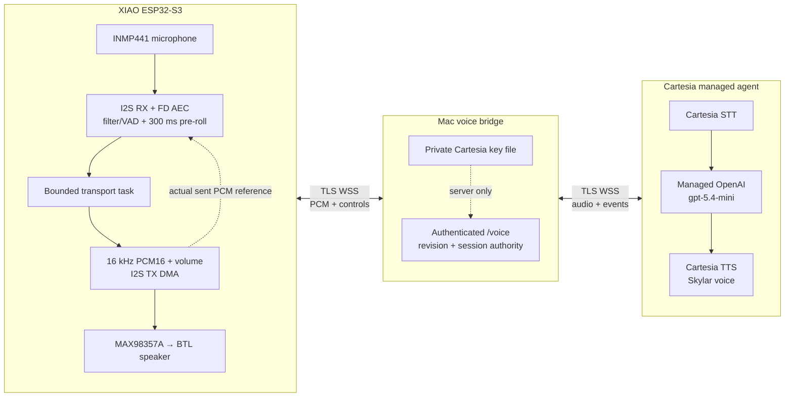
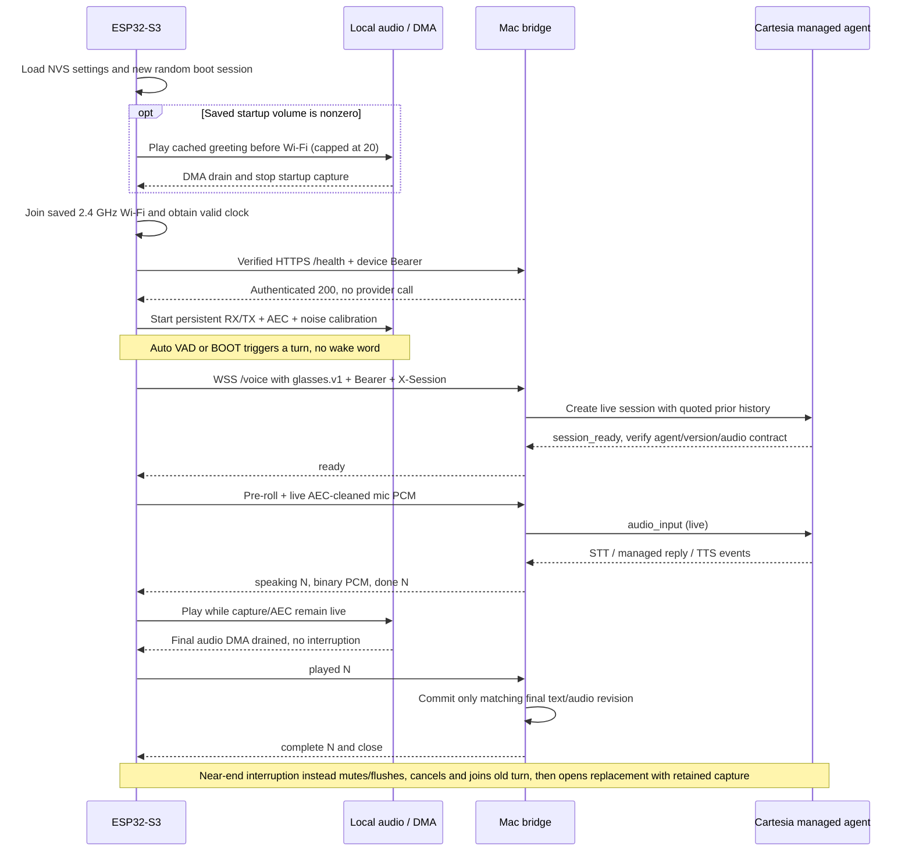
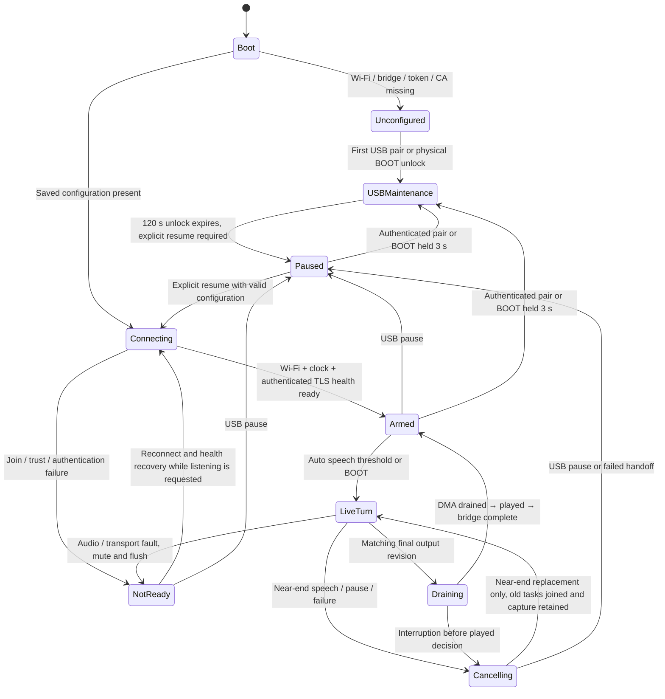

# Dan Glasses Firmware

**ESP32-S3 voice firmware + a dedicated private-LAN Python bridge.**

The current firmware identifies itself as **`5.2-duplex`**. It captures microphone audio while playing responses, applies on-device acoustic echo cancellation (AEC), and streams audio through an authenticated TLS WebSocket to a Mac. The Mac connects to a Cartesia managed agent: **Cartesia speech recognition → managed OpenAI `gpt-5.4-mini` → Cartesia speech synthesis**.

> **Implementation is not acoustic acceptance.** Full-duplex capture, playback, AEC, cancellation and played-history accounting exist in software. Clear audible speech, real acoustic echo suppression and reliable spoken interruption have **not** been demonstrated on the assembled glasses. The last owner-reported sound was hiss. Do not treat this repository as evidence of a completed spoken conversation or a hearing-safe wearable.

This is a fresh source export, not the old project's history or a backup of a working machine. No saved device configuration, provider key, device identity, private LAN fixture, runtime evidence, user recordings, downloaded models, CAD or hardware harness are supplied. The **only intentional credential exception** is the owner-authorized test Wi-Fi table below; it is README-only, not embedded in firmware. Setup creates new local private material.

## System at a glance



- **No wake word.** Auto mode starts a turn after sustained above-threshold speech; button mode uses BOOT. Level calibration is not speaker identification.
- **One Cartesia API key**, held only on the bridge. The LLM is OpenAI's model managed through Cartesia, **not a Cartesia-owned LLM**. No separate OpenAI key is used by this path.
- The managed agent has no tools, browser/search, actions, fallback model, initial greeting, check-ins or speculative generation; replies are capped at 256 output tokens. DeepSeek/direct-reply/search experiments are separate and paused.
- The Mac must remain awake, run the bridge in the foreground, reach Cartesia, and be reachable from the glasses on the approved private LAN. This is not a standalone cloud-connected device.
- Network audio is **headerless, little-endian signed PCM16, mono, 16,000 Hz** (32,000 bytes/s). I2S uses stereo 32-bit wire slots; that is not the network format.

## Boot and one voice turn



The greeting is compiled PCM in `startup_greeting.h`; it needs neither Wi-Fi nor a provider request. It plays **only at nonzero saved volume**. The last exercised unit was deliberately left at **volume `0`**, so it is silent, including at boot; that unit's NVS is not included here. A new/unreviewed settings load is capped at 20, and the greeting always uses that ceiling. Neither 20 nor any other software volume is a certified sound-pressure limit.

Provider turn detection is authoritative inside the live session. `stop_input` only stops further bridge input; it is **not** a Cartesia flush/commit signal. Closing an input half does not stop physical microphone/AEC capture.

## State, trust and authority



| Authority / boundary | Contract |
| --- | --- |
| Device audio owner | One I2S RX/TX owner maintains DMA timelines and the actual-sent playback reference. A dedicated AEC task processes capture; network work does not own the audio clocks. DIN is gated low for mute; this is not amplifier power shutdown. |
| Device transport / controller | The transport owns bounded network PCM rings; the controller tracks turn/revision state, interruption handoff and the DMA-drained `played` decision. Capture remains live during playback and bounded cancellation. |
| Bridge | Authenticates a narrow device token, enforces bounds/rates/session ownership, validates upstream events and commits only the matching final played revision. It cancels and joins tasks before acknowledging cancellation. |
| Provider | Owns STT, managed model inference, TTS and live turn boundaries. Runtime verifies the expected immutable agent version before uploading audio; it does not create or reconfigure the resource. |
| USB operator | First setup pairs an unconfigured device. Configured maintenance requires the current token or physical BOOT unlock; credential writes pause listening. Provisioning uses hidden Wi-Fi input and fresh nonce readiness. |
| Secrets | The bridge registry stores token SHA-256 digests; the raw device token is provisioned to NVS. NVS credentials are extractable: no flash encryption or tamper resistance is claimed. Provider keys and TLS private keys never belong on the device. |
| Network | Explicit HTTPS DNS origin + provisioned public CA; hostname/date verification and TLS 1.2 minimum on the bridge. No AP portal, discovery, HTTP fallback, browser Origin or query-string credential interface. |
| Retention | Bridge history is bounded in process memory: four user/assistant pairs, five-minute idle expiry, one-hour maximum age. Restart loses it. Cloud calls create provider-side records; local no-store responses do not promise provider deletion. |

### Live wire contract

`GET /voice` upgrades to WSS with **`Sec-WebSocket-Protocol: glasses.v1`**, **`Authorization: Bearer <device-token>`** and **`X-Session: <boot-session>`**. `GET /health` also authenticates, but does not contact a paid provider. `POST /reset` clears an idle authenticated session; a busy session cannot be reset.

| Direction | Message | Meaning |
| --- | --- | --- |
| Bridge → device | `ready` | Upstream session is ready and its immutable version/audio contract passed validation. |
| Device → bridge | Binary PCM | Live mono PCM16/16 kHz; nonempty even-length messages, at most 3,200 bytes each. |
| Bridge → device | `speaking N` | Begin output revision `N`. |
| Bridge → device | Binary PCM | Audio for the current revision, at most 3,200 bytes per message. |
| Bridge → device | `clear N` | Invalidate/flush that revision; it must not become played history. |
| Bridge → device | `done N` | Final text/audio revision is available; not yet a playback acknowledgement. |
| Device → bridge | `stop_input` | Stop accepting mic data for this exchange, without flushing provider VAD. |
| Device → bridge | `played N` | Matching final revision drained through device DMA without interruption. |
| Bridge → device | `complete N` | History committed; exchange ownership released. |
| Device → bridge | `cancel` | Abandon the exchange; no unplayed history commit. |
| Bridge → device | `cancelled` | Provider/device tasks joined and ownership released; reconnect barrier. |
| Bridge → device | `error CODE` | Mandatory playback flush. Codes include `unauthorized`, `invalid_audio`, `protocol`, `silence`, `timeout`, `upstream`, `busy`. |

An exchange is bounded to **60 seconds**, input to **10 seconds / 320,000 bytes**, and total generated output to **30 seconds / 960,000 bytes**, including cleared revisions. Defaults allow six voice requests/minute/device, 60 health requests/minute/device and two concurrent exchanges. These are safety/resource bounds, not a promise of conversational latency.

## Hardware contract — review before connecting or flashing

Target: **Seeed XIAO ESP32-S3, regular non-Plus, 8 MB flash and 8 MB OPI PSRAM**. USB identity alone does not establish the board model, memory, pin wiring or electrical safety.

| Signal | XIAO label | ESP32-S3 GPIO | Connection |
| --- | --- | --- | --- |
| Mic SD (data out) | D0 | 1 | INMP441 SD → ESP input |
| Shared BCLK / SCK | D1 | 2 | ESP clock → mic SCK and amplifier BCLK |
| Shared WS / LRC | D2 | 3 | ESP word-select → mic WS and amplifier LRC |
| Speaker DIN | D3 | 4 | ESP output → MAX98357A DIN |
| BOOT | Built-in | 0 | Button mode trigger / physical maintenance unlock |
| Status LED | Built-in | 21 | Active low |
| Mic supply | 3V3 | — | Mic VDD at 3.3 V; common ground |
| Amp supply | USB 5V | — | Amplifier supply at USB 5 V; common ground |
| Speaker | Amp `+` / `−` | — | At least 4 Ω, bridge-tied load (BTL); **neither terminal to ground** |
| Amp SD | NC on supplied daughterboard | **None assigned** | Actual breakout bias is unknown; no justified firmware shutdown GPIO |

The owner confirms a Seeed Studio XIAO ESP32-S3, INMP441 mic, MAX98357A amp and connected normal/passive speaker. The supply/wiring/load above were owner-attested, **not independently electrically measured**. Confirm the actual breakout schematic, amplifier SD bias, wiring, power and speaker rating before use. Do not invent an SD pin or equate DIN mute with disabling the amplifier. Keep initial tests away from ears; stop and disconnect power if anything heats, smells, distorts unexpectedly or behaves abnormally. No certified SPL, hearing protection, battery/charging design or wearable-safety approval is provided.

## Clean-checkout setup (macOS)

Commands run from the repository root. Install dependencies only after reviewing their download sources and licenses. None of the setup/build commands below implicitly authorizes flashing, provisioning, LAN exposure, provider creation or audible playback.

### Owner-authorized test Wi-Fi — private repository, not secret storage

The owner explicitly authorized publishing these **testing credentials in this README only**. Anyone with repository or history access can read them. **Do not use this network/password for production or reuse the password elsewhere.** Repository privacy is not a credential vault; changing/removing this table later does not remove it from existing clones/history.

| Test-network setting | Owner-authorized value |
| --- | --- |
| SSID | `Sodan` |
| WPA password | `123456789012` |
| Band | **2.4 GHz only** |
| Mac connectivity | Mac on the same reachable LAN; glasses must reach its bridge DNS hostname/port |

Enter these through the provisioning helper's hidden prompts when intentionally using this test network. They are not auto-loaded, and they do not authorize publishing provider keys, bridge tokens or private TLS keys.

### 1. Python bridge environment

Install **Python 3.12.13** from the [official Python release](https://www.python.org/downloads/release/python-31213/) and macOS command-line developer tools (`xcode-select --install`, if absent). The native test examples need a C++17 compiler; local TLS preparation needs `openssl` available in `/usr/bin:/bin:/usr/sbin:/sbin`.

```sh
python3.12 --version                 # must report 3.12.13
python3.12 -m venv .venv-bridge
. .venv-bridge/bin/activate
python -m pip install -r requirements.txt

python tools/device.py --help
python tools/device.py build --help
python tools/device.py flash --help
python tools/device.py provision --help
python tools/commissioning.py --help
python tools/cartesia_agent.py create --help
python tools/lan_bridge.py prepare --help
python tools/lan_bridge.py serve --help
```

`server/.env.example` is a **reference**, not an automatically loaded file or shell script. **Do not `source` it**, an old provider inventory, or any downloaded fixture. It defaults to a mock finite pipeline, not the live architecture above. The approved LAN launcher supplies an isolated, minimal environment with explicit `cartesia-stream` selection, so inherited pipeline selectors/proxies are not silently reused.


### 2. Pinned Arduino toolchain; compile without touching a device

Install the correct macOS architecture asset for **Arduino CLI 1.5.1** from its [official release](https://github.com/arduino/arduino-cli/releases/tag/v1.5.1), verify the release checksum, and put `arduino-cli` on `PATH`. The project does not install or upgrade global tools automatically.

```sh
arduino-cli core update-index --additional-urls https://espressif.github.io/arduino-esp32/package_esp32_index.json
arduino-cli core install esp32:esp32@3.3.10 --additional-urls https://espressif.github.io/arduino-esp32/package_esp32_index.json
arduino-cli lib install 'WebSockets@2.7.1'

python tools/device.py build --reference-board
```

| Dependency / setting | Required value |
| --- | --- |
| Arduino CLI | `1.5.1` |
| ESP32 Arduino core | `esp32:esp32@3.3.10` (bundled `esp_aec.h` FD AEC) |
| WebSockets | `2.7.1`, reviewed upstream commit `3af6593a00bd4dc8b18be5082575618cf2acc44d` |
| WebSockets aggregate source SHA-256 | `f97bf5299e4258a559e8c4ecd43afe8c1e2c9439d5db0f45abe5bc72625cfb7f` |
| Compile property | `compiler.cpp.extra_flags=-DNODEBUG_WEBSOCKETS` (disable credential-bearing library debug logs) |
| Board FQBN | `esp32:esp32:XIAO_ESP32S3:PSRAM=opi,FlashSize=8M,USBMode=hwcdc,CDCOnBoot=default,PartitionScheme=default_8MB,DebugLevel=none` |

The build helper checks **actual library source hashes**, not just the version label. If a package with the same label differs, investigate the reviewed dependency; do not bypass the check. Reference output is `.runtime/reference-build/` and **cannot be flashed** by the helper.

### 3. New server-only key and managed agent (separate provider approval)

**Existing owner installation:** reuse its already-approved agent and unchanged private LAN identity instead of creating new resources. Keep the existing key, metadata, device token and trust files outside Git; they were preserved in the original workspace, not copied into this repository. A compatible existing fixture can be served with:

```sh
python tools/lan_bridge.py serve --approved-lan \
  --directory '/absolute/private/path/to/existing-lan-fixture'
```

The Mac must still own that fixture's bind address, its DNS/certificate must remain valid, and its referenced provider key must remain readable privately. Do not regenerate tokens/certificates or recreate the agent just because this source checkout is new. The commands below are for a genuinely new installation with separate approval.

There is no included private key or saved agent fixture to reuse. First review Cartesia account entitlement, managed OpenAI model/voice availability, provider retention, quota and cost. Enter a newly approved Cartesia key interactively; never paste it into a command argument, source file, screenshot or `.env`.

```sh
umask 077
python tools/credentials.py --directory .secrets store cartesia

# Creates ONE provider resource; run only with explicit provider-write approval.
python tools/cartesia_agent.py create \
  --key-file .secrets/cartesia.key \
  --output .secrets/cartesia-agent.json \
  --name 'Dan Glasses dedicated voice agent' \
  --approved-provider-write
```

This creates a dedicated agent and private metadata containing its `agent_id`, immutable `agent_version_id`, origin, API version, model and voice ID. The reviewed contract is Cartesia API **`2026-08-14`**, managed **`gpt-5.4-mini`**, English and Skylar voice **`db6b0ed5-d5d3-463d-ae85-518a07d3c2b4`**. Public model/voice identifiers are not credentials.

An output file is reserved **before** the provider write. If creation fails or its outcome is unknown, keep that file and investigate the provider resource; **do not delete it and automatically retry**. Runtime never creates agents and fails on version drift before sending mic audio.

### 4. Prepare and serve a NEW private-LAN bridge (separate LAN approval)

Arrange a stable, lowercase DNS hostname that resolves **only to the Mac's chosen RFC1918 IPv4 address**, both on the Mac and on the glasses' 2.4 GHz network. A Mac-only `/etc/hosts` entry is insufficient for the ESP. Guest/client isolation, host firewall rules, VPN routing or sleep can make the bridge unreachable. Do not add router port forwarding, public ingress or an unrestricted firewall exception.

The variables below are intentionally non-routable placeholders: replace them with operator-reviewed values. Do not include angle brackets literally or use a numeric IP as the hostname.

```sh
LAN_BIND='<approved-Mac-RFC1918-IPv4>'
LAN_HOST='<approved-bridge-DNS-hostname>'

python tools/lan_bridge.py prepare \
  --approved-lan \
  --directory .secrets/lan-bridge \
  --bind "$LAN_BIND" \
  --hostname "$LAN_HOST" \
  --port 8443 \
  --provider-metadata-file .secrets/cartesia-agent.json \
  --provider-key-file .secrets/cartesia.key

python tools/lan_bridge.py serve \
  --approved-lan --directory .secrets/lan-bridge
```

`prepare` requires a **nonexistent** output directory and a private parent directory. It validates address ownership/DNS/metadata/key before writing a new device token, digest registry, TLS identity and manifest. Files must be user-owned, single-link, mode `0600`; private directories must be mode `0700`, without symlink paths. It references, rather than copies or prints, the server-only provider key.

Preparation prints the exact HTTPS origin, CA path and token path. The generated self-signed DNS certificate lasts **30 days**; it is the public trust anchor to provision, not a reason to disable certificate verification. `serve` checks the persisted identity and bind again, clears inherited provider/proxy configuration, and prints `VOICE_LAN_READY` when listening. It runs in the foreground, not as a daemon; stop with Ctrl-C. Keep its private directory while in use. Expired identities require a newly prepared/reviewed identity and device reprovisioning, not an insecure bypass.

`python -m server.server` deliberately binds **loopback only**. It is not a substitute for the separately approved LAN launcher.

### 5. Build, then separately approve flash and provisioning

Review the hardware table first. The following flags are attestations, **not** hardware detection. No tool should auto-select a serial port, and no full-chip erase belongs in this procedure.

```sh
# Compile only; writes a reviewed source/dependency/artifact receipt.
python tools/device.py build --actual-board --hardware-confirmed

# Read-only OS metadata inventory; does not open/reset the device.
python tools/device.py doctor
PORT='<freshly-reviewed-serial-port>'

# Separate approval: uploads the current reviewed actual-board build.
python tools/device.py flash \
  --port "$PORT" --approved-flash --hardware-confirmed

# USB can re-enumerate after upload. Re-inventory; set PORT again if it changed.
python tools/device.py doctor
PORT='<freshly-reviewed-post-flash-serial-port>'

# Use the EXACT origin printed by prepare, not an invented URL.
BRIDGE_ORIGIN="https://${LAN_HOST}:8443"
python tools/device.py provision \
  --port "$PORT" \
  --bridge-url "$BRIDGE_ORIGIN" \
  --token-file .secrets/lan-bridge/device.token \
  --ca-file .secrets/lan-bridge/tls.crt \
  --approved-device-write --hardware-confirmed
```

The actual-board receipt lives under `.runtime/` and binds current sources, toolchain inputs, build options and binary hashes. A stale receipt, changed dependency or reference build is refused. Flash uses the pinned upload recipe; it does **not** request a full-chip erase. Preserve NVS: it contains existing device settings/identity. Do not erase it merely to make a connection problem disappear.

Provisioning writes NVS, opens one USB connection at 115200 baud, verifies fresh current-firmware nonce readiness, and prompts invisibly for the **2.4 GHz** SSID and WPA password. First pairing needs no prior token; configured maintenance requires its **current** token or physical BOOT unlock. A newly generated replacement token cannot authenticate an already-configured unit by itself: use the physical unlock or an explicitly reviewed identity-rotation procedure. Holding BOOT for three seconds opens the 120-second maintenance window and pauses listening.

Provisioning leaves listening **paused** and does not make a voice/provider call itself. Keep bridge service running in its own terminal. Resume only after the USB unlock expires and after separate consent for live microphone upload/provider costs. A flash/reboot with saved configuration can independently reconnect and arm listening; the uploader is not a network-isolation tool.

### 6. Commission conservatively; do not confuse telemetry with sound

```sh
python tools/commissioning.py status \
  --port "$PORT" --approved-device-access --hardware-confirmed

# Device must already be paused. These do not change settings or resume it.
python tools/commissioning.py mic \
  --port "$PORT" --approved-device-access --hardware-confirmed
python tools/commissioning.py micdiag \
  --port "$PORT" --approved-device-access --hardware-confirmed

# ONLY after separate audible-test approval, away from ears, paused, volume 1..20:
python tools/commissioning.py tone \
  --port "$PORT" --approved-device-access --hardware-confirmed --approved-audio-test
```

The commissioning tool emits allowlisted telemetry, not raw logs or audio files. It never flashes, resets, writes settings, provisions, resumes listening or calls providers. The firmware may independently perform background networking; status does not pause an already-listening device.

For deliberate manual control, use a private USB serial terminal at **115200 baud** (for example, `arduino-cli monitor --port "$PORT" --config baudrate=115200`) and close it before another tool opens that port:

| Command | Effect / caution |
| --- | --- |
| `pause` | Stop listening and cancel/flush the current exchange. Use before diagnostics. |
| `status` | Read firmware, Wi-Fi/authentication, stream state, AEC/capture and memory telemetry. |
| `wifi` | Paused-only target-network scan / disconnect diagnosis; keep raw output private. |
| `volume 0` | Persist mute; cached greeting will also be silent. |
| `volume 1` … `volume 20` | Deliberate low-level commissioning settings only; not certified SPL. |
| `mode auto` / `mode button` | Persist speech-triggered mode / BOOT-triggered mode. Neither uses a wake word. |
| `gain 1` … `gain 64`; `sensitivity 1` … `sensitivity 10` | Tune mic gain / energy threshold; avoid mistaking noise sensitivity for voice recognition. |
| `calibrate`; `calibrate off` | Learn / clear voice-level calibration, not biometric speaker authentication. |
| `resume` | After unlock expires, join/authenticate and arm mic capture; speech can initiate paid calls. |
| `help` | Show the full firmware command list. |

Do not paste credentials into raw serial logs. Use the provisioning helper for hidden entry. A completed tone DMA drain or increasing `dma_eofs` is **not** proof of audible output, correct speaker polarity, echo cancellation or safe loudness.

## Verification evidence and outstanding limits

Software checks were rerun from this clean source export using the already-prepared Python 3.12.13 environment; no real provider or user services/data were used. Device rows record earlier physical development evidence, not validation of another board or acoustic assembly. Private evidence files are intentionally not shipped.

| Area | Observed evidence | What it does **not** establish |
| --- | --- | --- |
| Python software | All 140 tests passed from this source export in 28.784 s. | A newly installed dependency environment, provider entitlement, physical behavior or acoustic quality. |
| Portable firmware logic | Both native protocol and stream C++17 executables passed from this export with `-Wall -Wextra -Werror`. | Actual ESP scheduler, DMA timing, electrical wiring or acoustics. |
| Isolated integration | Both streaming HTTPS/WSS and finite-pipeline provider fixture smokes passed from this export. | A real provider conversation or audible speech. |
| Visual documentation | All three Mermaid diagrams parsed and rendered in Chromium with Mermaid 11.12.0. | Pixel-identical rendering across every GitHub client/theme. |
| Current flash | `5.2-duplex` flashed to the reviewed regular XIAO; four flashed region hashes verified; NVS `0x9000..0xDFFF` preserved. | The same hardware/flash contents on a reader's device. |
| Current live readiness | Fresh USB nonce, 2.4 GHz join, private TLS health 200 and live AEC capture ran for about 70 seconds without a speech trigger. No provider call in that probe; output volume remained 0 and listening was paused afterward. | Audible output, a completed spoken turn, acoustic echo rejection or successful interruption. |
| Earlier scripted device transport | A previous iteration sent 190,720 mic bytes over an actual WSS path; output arrival caused near-end cancellation while muted. | Whether detection was false, or real acoustic barge-in quality. |
| Earlier real-provider attempts | Turns terminated after roughly 2–3 seconds; root cause was not established. | That the current changes fix that failure. |
| Acoustic / safety acceptance | Not completed; owner last reported hiss. | Intelligible speech, stable double-talk/echo handling, latency targets or hearing-safe SPL. |

Current source fixes nested setup-time Wi-Fi joining, preserves `ready`/`status`/`pause` while joining, removes competing reconnect calls, restores bounded TLS operation/close guards, and latches transport/audio failure causes. The **15-second frame**, **5-second send** and **30-second provider-read** policies are not a proven root-cause fix for the earlier 2–3-second terminations.

### Reproduce software checks (no hardware or paid provider)

These are operator-run validation commands, not automatic setup steps:

```sh
python -m unittest discover -s tests -v
mkdir -p .runtime/native
c++ -std=c++17 -Wall -Wextra -Werror tests/firmware_protocol.cpp -o .runtime/native/firmware_protocol
.runtime/native/firmware_protocol
c++ -std=c++17 -Wall -Wextra -Werror tests/firmware_stream.cpp -o .runtime/native/firmware_stream
.runtime/native/firmware_stream

python tools/smoke_bridge.py --help
python tools/smoke_bridge.py --stream-fixture
python tools/smoke_bridge.py --provider-fixture
```

The fixture modes generate isolated dummy credentials/TLS identities and temporary data; they do not require or reuse real private inventories. The stream fixture exercises the native managed-agent WSS bridge. The provider fixture exercises the **separate finite pipeline** adapters, including dummy search; neither is a paid cloud acceptance test.

## Optional finite pipeline / offline evaluation — not the live device path

`VOICE_BACKEND=pipeline` exposes finite **`POST /ask`** WAV-in/WAV-out, plus authenticated health/reset. It is distinct from `VOICE_BACKEND=cartesia-stream` and its `/voice` PCM WebSocket. Do not combine pipeline provider selectors with managed-agent mode; startup rejects conflicting settings rather than silently falling back.

| Evaluation mode | Included implementation | Status / boundary |
| --- | --- | --- |
| Mock speech/reply | `MockSpeech` / `MockReply` in `server/backends.py` | Explicit test behavior, never a fallback from failed real providers. |
| Offline speech | whisper.cpp CLI + CPU Piper + FFmpeg resampling | Opt-in STT/TTS evaluation; models and external executables are not included. A mock reply is still mock reasoning, not a local LLM. |
| Cartesia batch speech | `ink-whisper` STT + stable `sonic-3`, `sonic-3.5` or `sonic-3.6` TTS choices | Requires separately approved model/voice/language/key configuration. Not managed-agent streaming. |
| Direct replies / DeepSeek profile | Direct chat adapter with explicit origin/model/key and API style | Paused experiment, not called by the current Cartesia-only agent. |
| DeepSeek web search | Direct documented search transport, explicit opt-in | Paused; not assumed to work through a chat gateway. Different-origin credentials are not interchangeable. |

For optional offline speech, install **whisper.cpp CLI 1.9.2** and **FFmpeg 8.1.1** separately, review their build/licenses, then:

```sh
python -m pip install -r requirements-speech.txt
python tools/models.py --help
python tools/models.py --directory models
python tools/smoke_bridge.py --local-speech
```

`whisper-cli` and `ffmpeg` must be on `PATH`. The model helper downloads only the named public assets with byte limits and SHA-256 checks: `ggml-tiny.en-q5_1.bin` and Piper `en_US-ljspeech-medium.onnx` plus its JSON config. Piper produces 22,050 Hz audio; FFmpeg converts it to board-safe 16,000 Hz. Model/voice licensing is separate. FFmpeg is normally LGPL-2.1+; an `--enable-gpl --enable-version3` build is GPLv3+. No binaries/models are vendored here.

## Source map

All paths below are included in this export.

| Area | Files | Responsibility |
| --- | --- | --- |
| Firmware entry / lifecycle | `firmware/voice_assistant/voice_assistant.ino` | Boot, NVS, USB commands, Wi-Fi/TLS readiness, VAD trigger and turn orchestration. |
| Full-duplex audio | `duplex_audio.h`, `duplex_audio.cpp`, `duplex_clock.h`, `speech_filter.h` (same sketch directory) | Shared I2S ownership, RX/TX DMA, actual-played reference, FD AEC, filtering, interruption detection and timing checks. |
| Device protocols | `bridge_protocol.h`, `wifi_join.h`, `stream_protocol.h`, `stream_controller.h`, `stream_transport.h` (same directory) | Provisioning/origin rules, join command policy, PCM/revision state, drain accounting and bounded TLS WSS transport. |
| Cached greeting | `firmware/voice_assistant/startup_greeting.h` | Compiled startup PCM; not an exported user recording. |
| HTTP / authentication | `server/server.py` | Private token registry, rate/session/history bounds, finite pipeline app and loopback launcher. |
| Live streaming | `server/streaming.py`, `server/cartesia_agent.py` | Native concurrent WSS, provider version pinning, cancellation, revision events and played-history commit. |
| Finite pipeline | `server/backends.py`, `server/turns.py`, `server/audio.py` | Explicit backend selection, bounded speech/reply/search adapters and finite WAV validation. |
| Configuration reference | `server/.env.example` | Dummy/reference values only; not a sourced environment. |
| Device operations | `tools/device.py`, `tools/commissioning.py` | Pinned build receipts; separately approved flash/provision; allowlisted telemetry/audio commissioning. |
| Private preparation | `tools/credentials.py`, `tools/cartesia_agent.py`, `tools/lan_bridge.py` | Hidden credential storage, one-time approved provider creation and isolated private-LAN service. |
| Software fixtures | `tools/smoke_bridge.py`, `tools/smoke_stream.py`, `tools/stream_client.py`, `tools/agent_fixture.py`, `tools/provider_fixture.py`, `tools/test_server.py` | HTTPS/WSS smoke, explicit finite-pipeline health/WAV client, and dummy upstream/client utilities; no saved private fixture. |
| Offline assets | `tools/models.py`, `requirements-speech.txt` | Explicit optional model download and speech dependency pins. |
| Tests | `tests/test_bridge.py`, `test_backends.py`, `test_providers.py`, `test_cartesia.py`, `test_device.py`, `test_commissioning.py`, `test_lan_bridge.py`, `firmware_protocol.cpp`, `firmware_stream.cpp` (all under `tests/`) | Python contracts and portable C++ protocol/stream tests. |
| Repository hygiene | `.gitignore`, `.gitattributes`, `requirements.txt` | Exclude local private/generated material, normalize source and pin bridge dependencies. |

`.gitignore` is a convenience, not a security boundary. Before sharing changes, independently review tracked content and scan for secrets/private data. Never add `.secrets/`, `.runtime/`, environment files, token registries, keys/certificates, serial transcripts, recordings or model/build artifacts. A source-only export deliberately cannot reproduce a user's private runtime state.

## Attribution and licensing boundary

This work started from [vishwab0815/3D-glasses](https://github.com/vishwab0815/3D-glasses), starting commit [`9132facdfe7565e4a70b4ab9d54146809fae1ed5`](https://github.com/vishwab0815/3D-glasses/commit/9132facdfe7565e4a70b4ab9d54146809fae1ed5). The firmware/bridge here have since been substantially reworked; the original history and legacy backups are not part of this export.

**No upstream root `LICENSE` was found during preparation, and this export does not invent one or assume MIT permission.** Attribution is not a license grant. Clarify upstream rights before redistribution or broader use; keeping a repository private does not itself resolve licensing. Dependencies, downloaded models/voices, provider services and any incorporated media retain their own licenses/terms.
